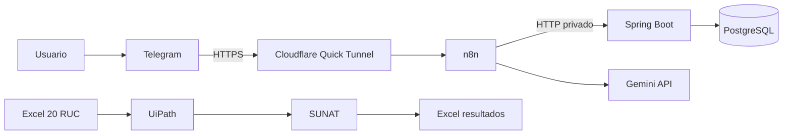

# Proyecto RPA 1 — Grupo X (borrador para completar con evidencias)

**Fecha:** 4 de noviembre de 2026. **Caso:** Clínica Soraka, negocio ficticio.

## Resumen y alcance

Dos procesos de un mismo negocio: consulta de 20 RUC empresariales en SUNAT con UiPath y respuesta a preguntas frecuentes por Telegram mediante n8n, API Spring Boot y Gemini. No hay historias clínicas, pagos ni reserva efectiva de citas. Los datos comerciales son ficticios.

## Rutas laborales

| Ruta | Funciones vinculadas al caso | Evidencia de competencias |
|---|---|---|
| Desarrollador RPA | Analizar el proceso tributario, construir selectores y controlar excepciones por fila | Robot UiPath y libro Excel revisado |
| Desarrollador de integraciones | Modelar datos, construir API, migraciones y despliegue local | Código Spring Boot, Compose, pruebas de endpoints |
| Especialista en automatización con IA | Diseñar flujo, contexto, restricciones y contingencias | Workflow n8n y pruebas de respuestas fundamentadas |

Estas rutas son una clasificación del trabajo del proyecto; los cargos y requisitos concretos dependen del empleador.

## Certificaciones pertinentes

1. [UiPath Automation Developer Associate](https://academy.uipath.com/certifications): cubre identificación de procesos y automatizaciones simples con Studio, Robot y Orchestrator. Pertinente para la primera implementación RUC.
2. [UiPath Automation Developer Professional](https://academy.uipath.com/certifications): evalúa desarrollo autónomo de soluciones complejas y experiencia con el Robotic Enterprise Framework. Pertinente como progresión de la ruta RPA.
3. [Google Cloud Generative AI Leader](https://cloud.google.com/learn/certification/generative-ai-leader): cubre fundamentos de IA generativa, ofertas de Google Cloud y mejora de resultados del modelo. Pertinente para comprender los límites del chatbot; no reemplaza experiencia técnica con Gemini API.

## Arquitectura

La API y PostgreSQL están en la red privada de Compose. n8n tiene volumen SQLite propio. Las dos automatizaciones comparten el caso de negocio, pero no intercambian datos. Se usa un webhook de Telegram con secreto de cabecera, validación de entrada y respuesta de contingencia.

## Justificación técnica

- Spring Boot 4.1.2 y Java 25 permiten una API REST con migraciones Flyway y validación JPA.
- PostgreSQL conserva los datos comerciales; n8n conserva configuración y workflow en su volumen propio.
- La búsqueda FAQ normaliza tildes y minúsculas y puntúa coincidencias léxicas. No es búsqueda semántica y puede omitir paráfrasis.
- Gemini redacta a partir de datos recuperados; si no hay coincidencia, no se consulta el modelo. Si la IA falla, se usa la respuesta FAQ.
- El túnel ofrece HTTPS temporal para la demo. No es un despliegue permanente.
- UiPath se ejecutará localmente para indicar selectores contra SUNAT y tratar verificaciones interactivas mediante revisión humana.

## Evidencias por insertar tras ejecución real

1. Capturas del flujo n8n y de respuestas de Telegram para ubicación, sábado, precio, cita y dato ausente.
2. Capturas de Studio, ejecución parcial y revisión manual de varias filas RUC contra SUNAT.
3. `ruc_resultado.xlsx` con 20 filas, cuatro campos oficiales cuando la consulta funcione, estado y observación por fila.
4. Pruebas de disponibilidad de API y contenedores, sin mostrar tokens.
5. Video opcional de funcionamiento.

Al completar estas evidencias, exportar como `Proyecto_RPA_1_GrupoX.pdf`. No presentar este borrador como ejecución terminada.
